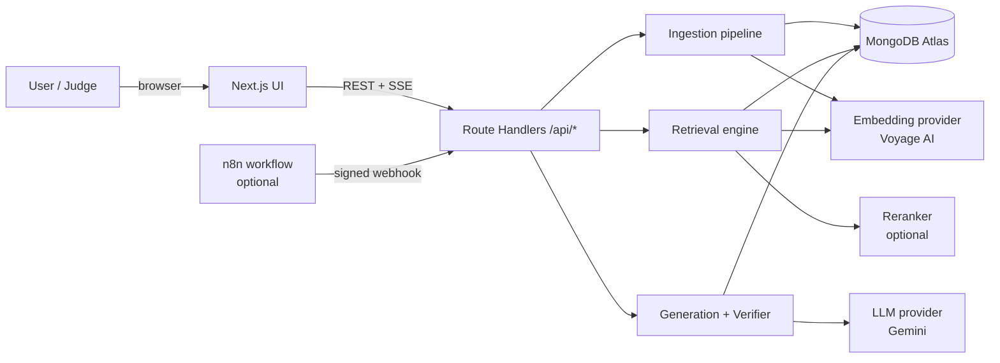
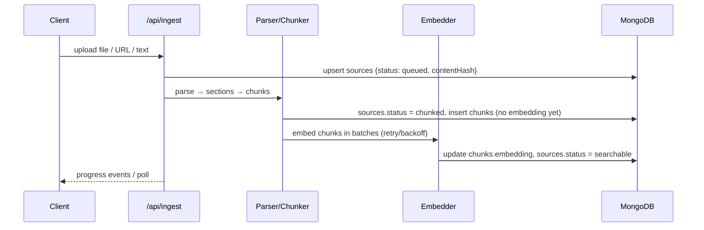
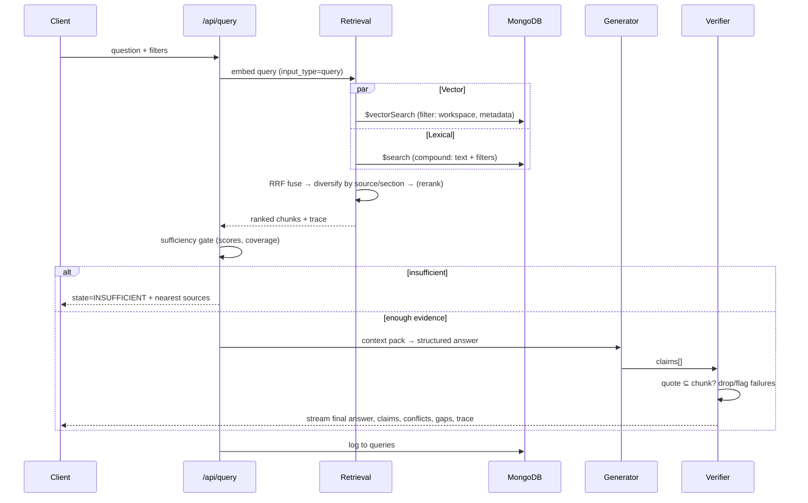
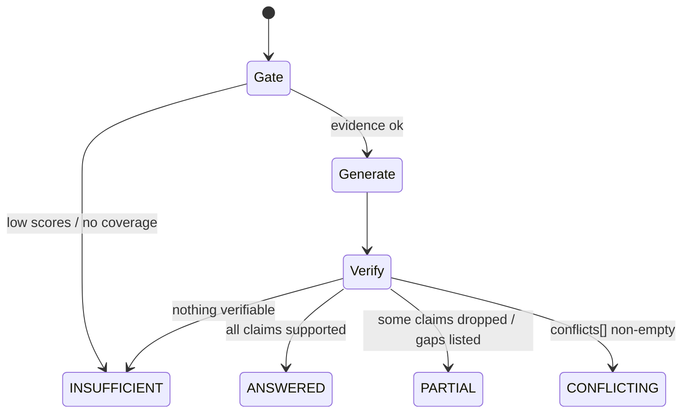

# ARCHITECTURE

**Status:** BASELINE v0.1 — redraw/update when decisions change. Diagrams are Mermaid (render in GitHub/Antigravity preview).

## 1. System context


## 2. Components
| Component | Responsibility | Key notes |
|---|---|---|
| **UI** | Library, chat/answer, Evidence panel, Source viewer, X-ray, Eval page | Streams via SSE; citation chips open viewer |
| **API layer** | Validation (zod), rate limiting, auth guard, orchestration | Thin; logic lives in `lib/` |
| **Ingestion** | parse → clean → section detect → chunk → embed → upsert | Idempotent by `contentHash`; resumable status machine |
| **Retrieval engine** | Query embed, `$vectorSearch`, `$search`, RRF, diversification, rerank, trace | Pure functions + provider interfaces → testable |
| **Generation** | Context packing, prompt, structured output, verifier, state machine | Verifier is the trust anchor |
| **Eval harness** | Runs `eval_cases` against any config; stores `eval_runs` | Shared by CLI and Eval page |
| **MongoDB Atlas** | System of record + vector + lexical indexes + TTL | Single store: sources, chunks, embeddings, metadata together |

## 3. Data flow — ingestion

*Index sync note:* Atlas Vector/Search indexes update asynchronously — a source may need a few seconds after `embedded` before it's retrievable. UI should show "indexing…" until a probe query finds it (or poll `status`).

## 4. Data flow — query


## 4b. Answer state machine


## 5. Deployment topology
```
Browser ──HTTPS──> Vercel (Next.js: SSR + serverless route handlers)
                       ├──TLS──> MongoDB Atlas (M0 → M10 if needed), region near users (e.g. Mumbai)
                       ├──HTTPS─> Voyage AI (embed/rerank)
                       └──HTTPS─> Gemini API (LLM)
(optional) n8n Cloud ──signed webhook──> /api/ingest
```
- Atlas network access must permit Vercel's dynamic egress (commonly `0.0.0.0/0` for hackathons — compensate with a strong DB password, least-privilege DB user, and no public exposure of the URI).
- Mongo client cached on `globalThis` to avoid connection storms in serverless.

## 6. Failure modes & responses
| Failure | Detection | Response |
|---|---|---|
| Embedding API 429/5xx | HTTP status | Retry w/ backoff; mark `sources.error`; UI shows "retrying…"; fallback provider via env |
| LLM timeout/error | Timeout, 5xx | Return retrieved evidence + banner "generation unavailable"; never blank |
| Index not ready | Probe returns 0 hits | UI "indexing…", poll |
| Duplicate upload | Unique `(workspaceId, contentHash)` | Return existing source |
| Malformed/encrypted PDF | Parser throws | `status=failed` + readable message |
| Prompt injection in source | Heuristic scan + prompt rules | Mark chunk `flags:["suspicious"]`, exclude or sandbox |
| Cold start slow | First request latency | Warm via `/api/health` ping before demo |
| Cluster paused/limits (free tier) | Connection errors | Health check in README; keep corpus small |

## 7. Security boundaries
- Client never sees API keys or the Mongo URI; embeddings are excluded from API responses (`projection: {embedding: 0}`).
- Admin routes require `ADMIN_TOKEN`; n8n route requires HMAC.
- Rate limit by IP (in-memory or a Mongo-backed counter with TTL).
- Uploaded content is untrusted: parse in try/catch, size/type limits, strip scripts from HTML.

## 8. Scalability notes (for Q&A)
- Corpus-per-workspace filtering keeps vector search scoped; use `numCandidates` ≈ 10–20× limit.
- Move heavy parsing to a worker (Render/Fly) and use Mongo change streams or a queue collection for live status.
- Quantisation / smaller dims reduce index size; Automated Embedding removes the app-side embedding pipeline (needs M10+).

## 9. Why MongoDB (talk track)
One document store holds raw source, chunks, vectors, metadata and logs → no sync between a vector DB and a primary DB; metadata pre-filters run inside the vector query; Atlas Search provides BM25 for exact tokens; TTL expires sandbox data; schema validation protects ingestion; aggregation pipelines power eval comparisons.
